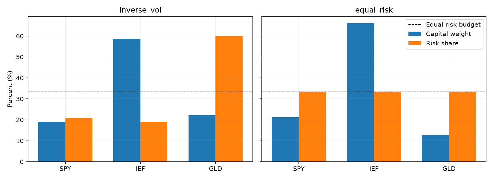

# Market & Portfolio Lab

**A learning-driven research project for systematic ETF allocation, risk budgeting, and auditable portfolio accounting.**

从真实行情出发，逐步建立“研究 → 配置 → 模拟执行 → 对账 → 复盘”的工作流程。英文概览便于展示；课程、问答和研究解释以中文为主。

**Status:** seven completed lessons; 26 offline tests; historical simulation only. No live trading, broker integration, or proven alpha claim.

## Start here

- **[Learning Q&A / 学习问答与重难点](docs/learning_qa.md)** — curated questions from the learning process, worked examples, and common misunderstandings.
- [Methodology & limitations](docs/methodology.md) — what the backtest actually assumes.
- [Reproduction guide](docs/reproducibility.md) — setup, data acquisition, and sequential execution.
- [Roadmap](docs/roadmap.md) — implemented capabilities versus planned research.
- [Development notes](docs/development_notes.md) — original Chinese project record; generated `reports/` paths refer to local artifacts.

## Learning stages

- **Stage I — allocation and accounting (01–05):** risk budgets, constraints, timing, costs and a reconciled ledger.
- **Stage II — signals and strategy validation (06 onward):** turn observations into exposures; assess benefits, cash effects, failure modes and validation quality. Lesson 06 adds a fixed monthly 200-day-SMA filter to ERC, leaving disabled allocations in cash.
- **Later:** frozen-rule forward simulation and decision reports; ML only after credible baselines and validation.

See the [lesson 06 research design](docs/06_research_design.md). Historical segments are descriptive diagnostics, not untouched out-of-sample evidence.

## Research questions

1. How do price returns differ from distribution-adjusted returns?
2. What changes when a portfolio is held versus rebalanced monthly?
3. Why are capital weights different from contributions to portfolio volatility?
4. Does equal risk contribution improve outcomes relative to inverse-volatility allocation?

5. How do estimation windows, position caps and rebalance thresholds change stability and execution?

The project studies SPY (US large-cap equities), IEF (US intermediate Treasury bonds), and GLD (gold). These are teaching assets, not a personalized allocation recommendation.

## Learning sequence

| Lesson | Notebook | Read-only HTML after download/clone | Main deliverable |
| --- | --- | --- | --- |
| 01 Data and returns | [Notebook](notebooks/01_data_and_returns.ipynb) | [Report](docs/reports/01_data_and_returns.html) | Snapshot audit, returns, drawdowns and correlations |
| 02 Portfolio ledger | [Notebook](notebooks/02_portfolio_ledger.ipynb) | [Report](docs/reports/02_portfolio_ledger.html) | Shares, cash, distributions, trades and reconciliation |
| 03 Risk allocation | [Notebook](notebooks/03_risk_allocation.ipynb) | [Report](docs/reports/03_risk_allocation.html) | Risk decomposition and inverse-volatility targets |
| 04 Equal risk contribution | [Notebook](notebooks/04_equal_risk.ipynb) | [Report](docs/reports/04_equal_risk.html) | Correlation-aware allocation and solver validation |

| 05 Allocation constraints | [Notebook](notebooks/05_allocation_constraints.ipynb) | [Report](docs/reports/05_allocation_constraints.html) | Window sensitivity, target caps, prior-close rebalance thresholds |

| 06 Trend filter | [Notebook](notebooks/06_trend_filter.ipynb) | [Report](docs/reports/06_trend_filter.html) | Signal-to-weight mapping, cash, lag, annual diagnostics and costs |

| 07 Exposure controls | [Notebook](notebooks/07_exposure_controls.ipynb) | [Report](docs/reports/07_exposure_controls.html) | Fixed exposure, dynamic scaling and labeled post-hoc diagnostics |

GitHub renders notebooks directly. HTML files should be downloaded or opened locally; GitHub Pages is not configured. Saved outputs are illustrative historical runs, not current market signals.

## Selected historical results

Common comparison period: **2010-08-02 through 2026-10-06**. Initial capital: **USD 100,000**. Monthly rebalancing, fractional shares, long-only, no leverage, **5 bps per side** modeled cost. Dynamic methods use 126 prior daily returns. See [methodology](docs/methodology.md) for accounting approximations.

| Portfolio | CAGR | Annual volatility | Max drawdown | Modeled fees |
| --- | ---: | ---: | ---: | ---: |
| 60/40 stocks/bonds | 9.75% | 9.74% | -21.20% | $440.13 |
| Three-asset equal weight | 8.50% | 8.52% | -17.01% | $481.37 |
| Inverse volatility | 6.32% | 6.51% | -17.33% | $706.18 |
| Equal risk contribution | 6.41% | 6.35% | -17.89% | $823.98 |

**Finding:** equalizing estimated risk contributions did not improve every investment outcome. ERC slightly increased historical return and reduced volatility relative to inverse volatility, but had a deeper maximum drawdown and higher modeled fees. Total risk is not matched across portfolios; differences are not estimates of alpha.



Lesson 05 uses a later common start after 252-return warm-up. Its capped target overlay is not an ERC optimizer; thresholds use prior-close asset and cash weights. Its results must be compared within that lesson, not directly to the longer sample above.

Lesson 06 (2011-02-01–2026-10-06): adding the fixed SMA filter reduced historical maximum drawdown from 17.89% to 10.86%, but CAGR fell from 6.28% to 4.72%. Average actual cash rose to 29.60%, and modeled fees increased. This is a documented tradeoff, not evidence of timing alpha; see the lesson for annual failures and validation limits.

Lesson 07 adds explicit exposure controls: fixed 70% ERC returned 4.40% CAGR with a 12.80% maximum drawdown; scaling ERC by each month’s trend total exposure returned 4.78% with a 10.62% drawdown. The 70.20% full-sample mean-target control is labeled **POSTHOC**, not a tradable historical strategy. Similar exposure does not imply matched risk or causal attribution.

## Architecture

```text
Immutable market snapshot
        ↓
Historical return / covariance estimates and trend signals
        ↓
Dated target weights (decision date < execution date)
        ↓
Shared simulated execution and cash/share ledger
        ↓
Reconciliation, performance evaluation, learning reports
```

- `src/market_data.py`: download snapshots, validate data, verify checksums.
- `src/portfolio.py`: fixed/scheduled targets, transaction costs, distributions, cash and shares.
- `src/controls.py`: validated scaling of dated targets for explicit exposure controls.
- `src/signals.py`: audited prior-close SMA filter; disabled allocations remain in cash.
- `src/risk_models.py`: risk contributions, inverse-volatility allocation, ERC solver.
- `tests/`: hand-calculated accounting cases, solver invariants, timing and future-data perturbation tests.
- `scripts/run_lessons.py`: rerun the seven lessons on one explicitly selected local snapshot.
- `notebooks/`: explanations and executed examples; `build_*.py` are authoring helpers, not required for normal use.
- `docs/`: methodology, Q&A, roadmap, curated reports and figure.
- `data/`, `reports/`: local data and generated run artifacts, excluded from Git.

## Quick start

Use Python 3.11. From the repository root on macOS/Linux:

```bash
python3.11 -m venv .venv
source .venv/bin/activate
python -m pip install -r requirements.txt
python -m ipykernel install --prefix .venv --name market-portfolio-lab --display-name "Market & Portfolio Lab (Python 3.11)"
python -m unittest discover -s tests -v
```

On Windows use `.venv\Scripts\Activate.ps1` to activate. The existing `requirements-lock.txt` records a tested macOS x86_64 environment; it is not a universal cross-platform lock.

Download data yourself, subject to the provider's terms, then run the lessons:

```bash
python src/market_data.py --start 2010-01-01 --end 2026-10-07
python scripts/run_lessons.py --snapshot latest
```

The end date is exclusive. Re-downloading the same interval can yield revised data and different results. Raw prices are **not distributed** in this repository. See [reproduction details](docs/reproducibility.md) before comparing numbers.

To read or edit interactively:

```bash
python -m jupyterlab
```

For manual notebook execution, set `MARKET_LAB_SNAPSHOT` to a local snapshot ID before starting Jupyter, or edit the `SNAPSHOT` variable. Defaults retain the original teaching snapshot ID and fail clearly if it is absent.

## Validation and scope

The offline test suite checks accounting identities, distribution entitlement, month-boundary execution, future-data invariance, and ERC analytical properties. CI runs these tests on synthetic fixtures; it does not download Yahoo data or establish strategy profitability.

Current simplifications include ex-date cash availability, idealized opening fills, zero-interest cash, no personal taxes, and historical data revisions. Not a production trading system or investment advice.

## Development

Changes should state the research question, preserve benchmark comparability, include relevant tests, and document assumptions. See [CONTRIBUTING.md](CONTRIBUTING.md). The work was developed through human-directed, AI-assisted learning; explanations and generated code are accompanied by executable checks, not treated as proof by themselves.

No open-source license has been selected yet. Public availability does not grant a blanket reuse license; third-party data and dependencies retain their own terms.
